# MedHaven

**Toate medicamentele unui vârstnic, într-un singur loc, verificate deterministic și văzute de toți cei care au grijă de el.**

Pozezi cutiile și rețetele bunicii. MedHaven construiește graful ei terapeutic și găsește interacțiunile, dublurile și medicamentele nepotrivite vârstei. Apoi îi face un program zilnic simplu și o ascultă când spune cum se simte. Familia și medicul de familie văd aceeași fișă și aceleași alerte.

UniHack 2026 · tema **The Bloom** (Connected Communities, Mobility & Healthcare) → track-ul **Medical Renaissance** · iOS nativ (SwiftUI) + backend Python (FastAPI) + portal web.

> Prototip de hackathon. Nu pune diagnostice, nu schimbă și nu oprește medicamente și nu recomandă doze.

<p align="center">
  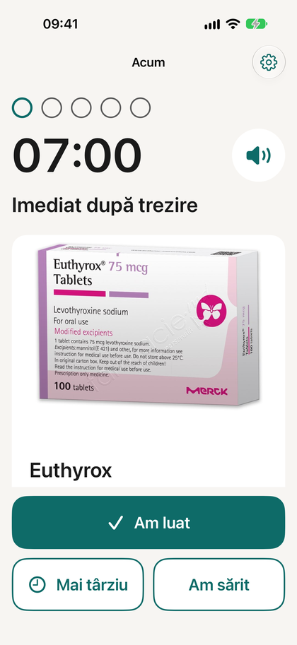
  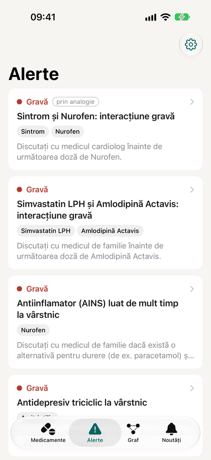
  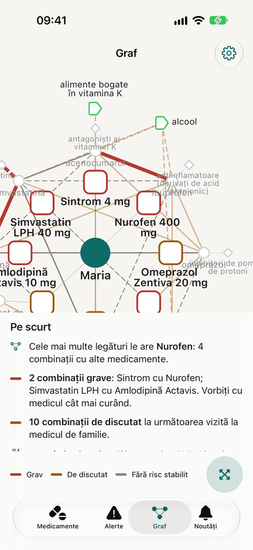
  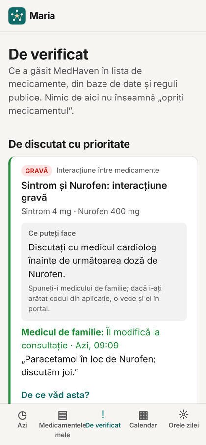
</p>

## Cuprins

- [Tema și problema](#tema-și-problema)
- [Soluția](#soluția)
- [Obiectivele](#obiectivele)
- [Funcționalitățile](#funcționalitățile)
- [Capturi din demo](#capturi-din-demo)
- [Specificații tehnice](#specificații-tehnice)
- [Sursele de date și licențele](#sursele-de-date-și-licențele)
- [Cum se rulează](#cum-se-rulează)
- [Ce NU face](#ce-nu-face)
- [Structura repo-ului](#structura-repo-ului)

## Tema și problema

The Bloom vorbește despre comunități conectate. La medicamente, comunitatea unui vârstnic e formată din pacient, familia lui și medicul de familie, iar cei trei văd de obicei liste diferite.

Un vârstnic cu 5–10 medicamente are rețete de la mai mulți specialiști, plus ce cumpără singur din farmacie: antiinflamatoare, suplimente. Niciun medic nu vede lista întreagă, medicii nu comunică între ei, iar singurul care „integrează” tratamentul e chiar pacientul. Costul se vede în spitale:

- **~1 din 10 internări ale vârstnicilor** e legată de o reacție adversă la medicamente: 10,0% la ≥65 de ani într-un spital din Irlanda (studiul ADAPT, 2023) și 8,7% într-o meta-analiză a 42 de studii, la pacienți de peste 60 de ani (Oscanoa et al., 2017).
- Comisia Europeană a estimat în 2008 că **~5% din toate internările** și **~197.000 de decese pe an** în UE sunt cauzate de reacții adverse.
- Polimedicația înseamnă **de ~3 ori mai multe șanse** ca o internare să fie legată de medicamente (OR 3,3, un studiu finlandez, 2016).
- Din 2 ianuarie 2024, NLM a oprit funcțiile de interacțiuni medicament–medicament din RxNav, deci nu mai există o sursă publică ușor de folosit.

Sursele și formularea exactă a fiecărei cifre sunt în [`docs/pitch/figures.md`](docs/pitch/figures.md).

## Soluția

```text
poza cutiei / a rețetei → nomenclatorul românesc → graful terapeutic → alerte deterministe, cu sursă
        → programul zilei → „Am luat” și check-in-ul vocal → familia și medicul de familie, în aceeași buclă
```

| Cine | Ce folosește | Ce vede și ce face |
|---|---|---|
| **Pacientul** (Maria, 78 de ani) | aplicația iOS, **modul senior** | doar ce are de luat acum, cu poza cutiei, butoane de 72 pt, citire cu voce; „Am luat”, „Mai târziu”, „Am sărit”; spune cu voce cum se simte sau „Pot să iau o aspirină?” |
| **Aparținătorul** (Ana, fiica ei, în alt oraș) | aplicația iOS, **modul aparținător** sau **pagina familiei** pe web | scanează cutiile și rețetele, vede lista, alertele cu sursa, graful, Noutăți (doze ratate, simptome, deciziile medicului), calendarul săptămânii și cutiuța de pastile |
| **Medicul de familie** (dr. Elena Popa) | **portalul web**, fără instalare | pacienții care i-au arătat codul QR, cu cei urgenți primii; fișa completă, inclusiv OTC-urile; decide pe fiecare alertă („Menține / Modific la consultație / Trimit la specialist” + notă), iar decizia ajunge la familie; tipărește fișa medicației pentru consultație |

**Regula de aur:** în fluxul normal nu rulează niciun LLM. Textul îl citește OCR-ul de pe telefon și vocea o transcrie tot telefonul. Potrivirea în catalog, simptomele, interacțiunile și programul sunt deterministe. Dacă există o interacțiune, cât de gravă e și ce se recomandă vin exclusiv din baze de date și reguli scrise, cu sursa afișată lângă fiecare alertă.

## Obiectivele

**Pentru produs**

1. **Lista completă într-un singur loc:** rețetele de la toți medicii și OTC-urile, adăugate din poza cutiei sau a rețetei, fără tastat.
2. **Alerte corecte și explicabile:** interacțiuni, dubluri și medicamente nepotrivite vârstei, din baze de date și reguli deterministe, fiecare cu sursa ei; LLM-ul nu decide nimic medical.
3. **Un program zilnic simplu pentru pacient:** cât mai puține momente pe zi, cu regulile de orar respectate (Euthyrox singur dimineața, calciul la 4 ore distanță), pe un singur ecran.
4. **Semnalele pacientului ajung la cine trebuie:** ce spune pacientul cu voce e corelat cu medicamentele lui, iar ce e grav ajunge la familie și la medicul de familie.
5. **Medicul de familie vede ce altfel nu vede:** OTC-urile și rețetele altor specialiști, într-un portal fără instalare, cu decizia lui întoarsă la familie.

**Pentru hackathon**

1. MVP-ul (F1–F10) rulează în scenariul demo de 3 minute de 3 ori la rând, pe două iPhone-uri și un laptop.
2. Feature freeze la S4. După el, doar repetiții, video-ul de rezervă și pitch-ul.
3. Pitch-ul arată problema, demo-ul, „LLM doar la margini” și drumul responsabil (GDPR, MDR).

## Funcționalitățile

| | Funcționalitate | Ce face |
|---|---|---|
| F1 | **Scanarea cutiei și a rețetei** | poză → OCR Apple pe telefon → potrivire în nomenclatorul românesc (nume comercial, concentrație, DCI) și parserul de posologie („1-0-1”) → confirmare cu câmpurile de verificat marcate; Gemini doar ca rezervă |
| F2 | **Codul DataMatrix** | codul GS1 obligatoriu în UE: GTIN, lot, data expirării; a doua scanare a aceleiași cutii e instantă; avertizare la cutie expirată sau adăugată de două ori |
| F3 | **Graful terapeutic** | pacient → medicamente → substanțe → clase ATC → alimente, cu muchiile colorate după severitate; același renderer în aplicație (offline) și în portal |
| F4 | **Motorul de interacțiuni** | medicament–medicament (cu severitate), medicament–aliment, dubluri terapeutice; analogia de clasă când DDInter nu dă nivelul (acenocumarol → warfarină), marcată ca atare |
| F5 | **Verificările pentru vârstnici** | reguli Beers 2023 / STOPP v3 (AINS cronic, amitriptilină, IPP > 8 săptămâni) și scorul anticolinergic ACB, cu pragul de risc |
| F6 | **Programul zilnic optimizat** | solver cu constrângeri: pe stomacul gol, cu masa, separări minime; minimizează numărul de momente (Maria: 5 momente pentru 8 medicamente); orele zilei se pot schimba oricând |
| F7 | **Modul senior** | „Acum”: poza cutiei, câte bucăți, instrucțiunea, citire cu voce; „Am luat” cu anulare; funcționează și offline, confirmarea pleacă la revenirea internetului |
| F8 | **Check-in-ul vocal** | „Cum vă simțiți azi?” → transcriere pe telefon (ro-RO) → simptome dintr-un vocabular fix → corelare cu efectele adverse și alertele existente → escaladare la familie |
| F9 | **Aparținătorul** | Noutăți: alerte noi, doze ratate, check-in-uri, deciziile medicului; notificări pentru ce e grav |
| F10 | **Portalul medicului de familie** | autentificare cu cod; pacienții adăugați prin QR (token de 72 h); fișa care se actualizează singură (SSE); decizie + notă pe alertă; „Dacă prescriu…?”; fișa medicației pentru consultație, de tipărit |
| X1 | **„Pot să iau…?”** | același motor rulat ca what-if; răspunsul depinde de severitate și nu spune niciodată „puteți lua” |
| X2 | **„Medic nou”** | o rețetă nouă (Fromilid, ORL) dă alerta critică live pe telefonul familiei și în portal |
| E2–E3 | **Pagina familiei pe web** | „Azi” cu „Am luat”, „Medicamentele mele” cu explicații, „De verificat”, calendarul săptămânii și modul „Pregătesc cutiuța”; pentru cine n-are aplicația la îndemână |
| – | **Profilul de sănătate** | înălțime, greutate, afecțiuni; opțional la onboarding, vizibil medicului în portal și pe fișa tipărită |

## Capturi din demo

Capturile sunt din aplicația reală, pe pacientul demo fictiv (Maria, 78 de ani, 8 medicamente de la 5 medici). Cele din aplicație vin din turul automat de review pe simulator, cele web din portalul pornit cu `make demo`.

### Aplicația iOS: aparținătorul

| Bun venit | Confirmarea scanării | Medicamentele | Alertele |
|---|---|---|---|
| 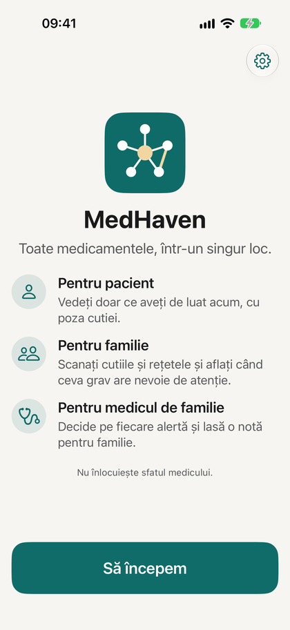 | 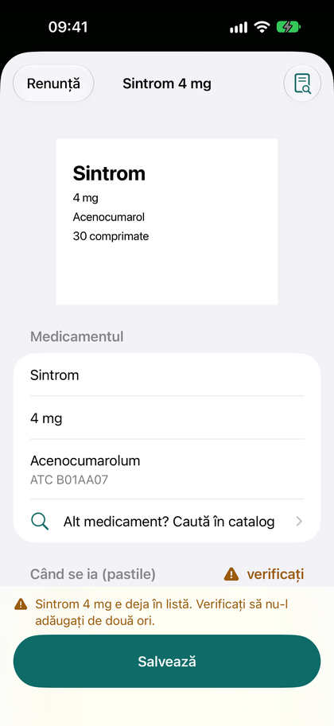 | 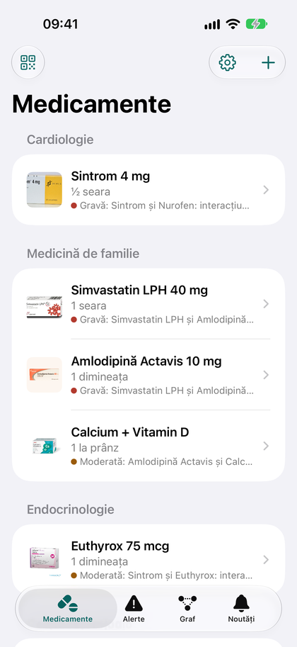 |  |

| Detaliul alertei | Graful terapeutic | Noutăți | „Arată medicului” |
|---|---|---|---|
| 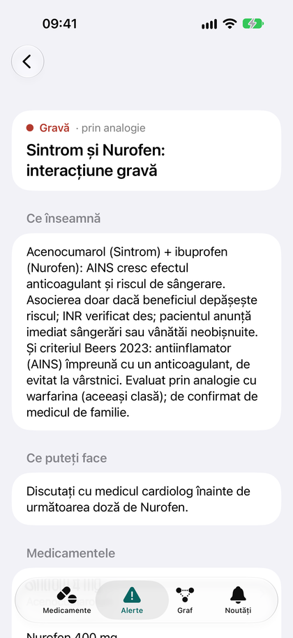 |  | 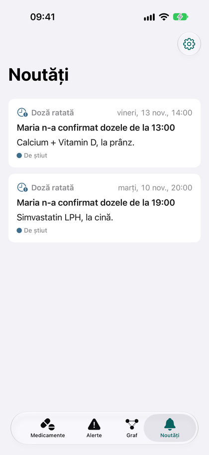 | 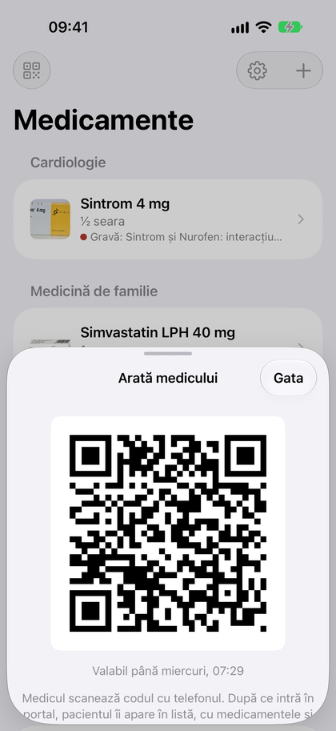 |

### Aplicația iOS: modul senior

| Acum | După „Am luat” | Ziua de azi | Check-in vocal |
|---|---|---|---|
|  | 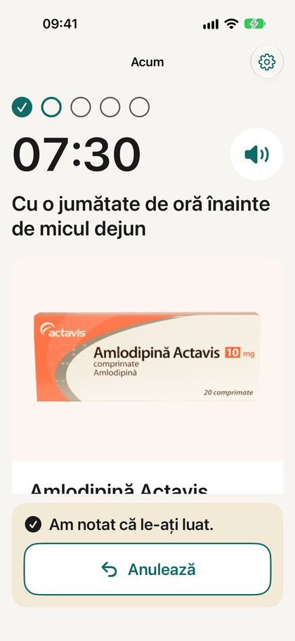 | 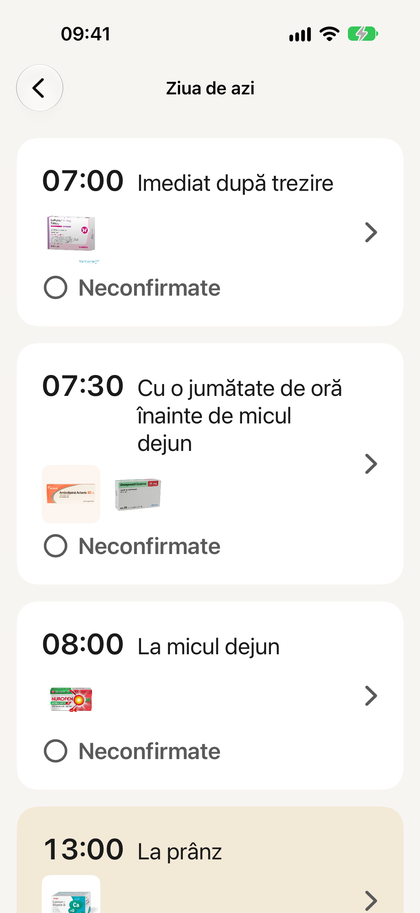 | 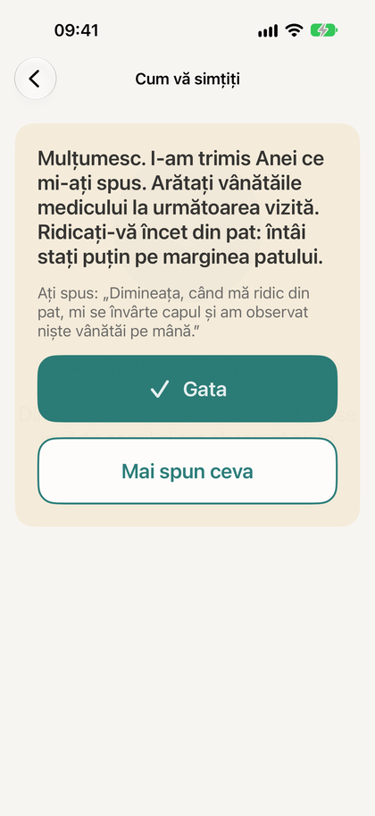 |

### Portalul medicului de familie

| Pacienții mei |
|---|
| 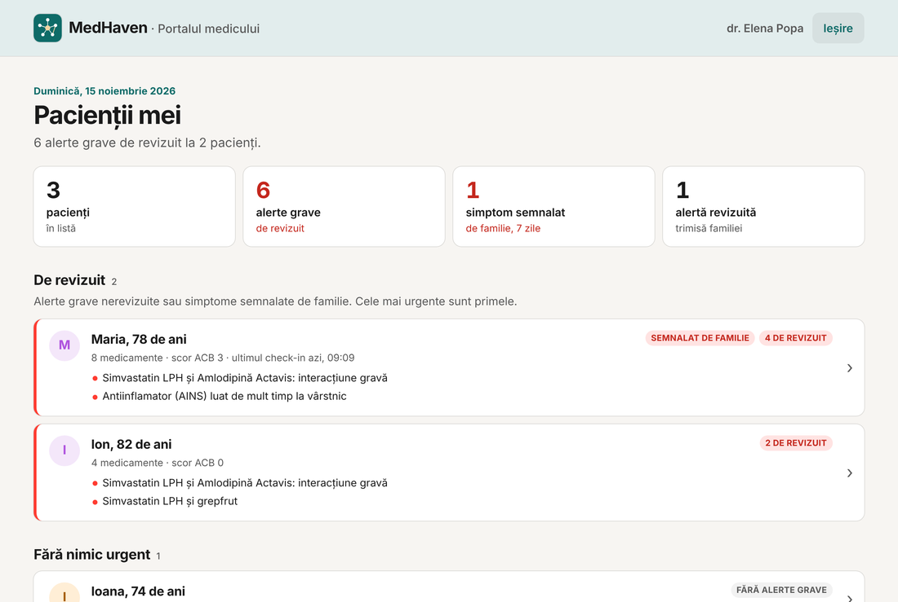 |

| Fișa pacientului, cu profilul și decizia pe alertă |
|---|
| 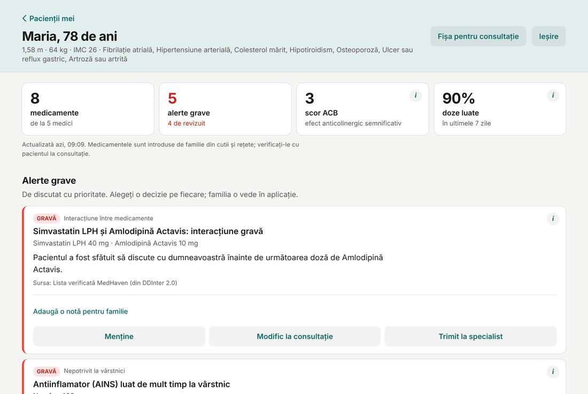 |

| Fișa medicației pentru consultație (de tipărit) |
|---|
| 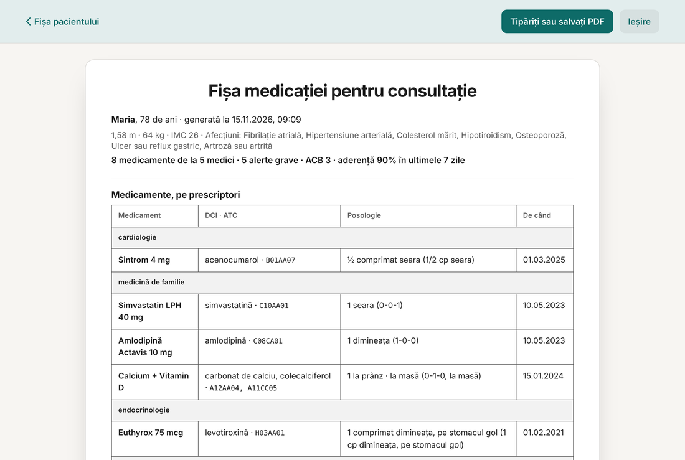 |

### Pagina familiei pe web

| Azi | Medicamentele mele | De verificat | Calendar și cutiuța |
|---|---|---|---|
| 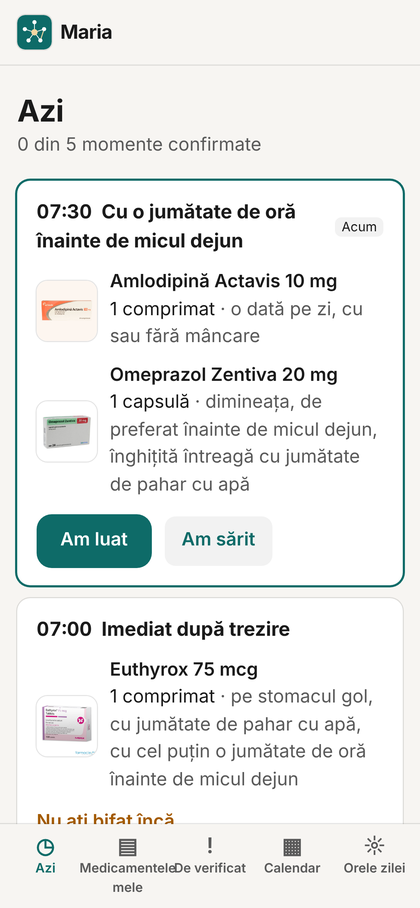 | 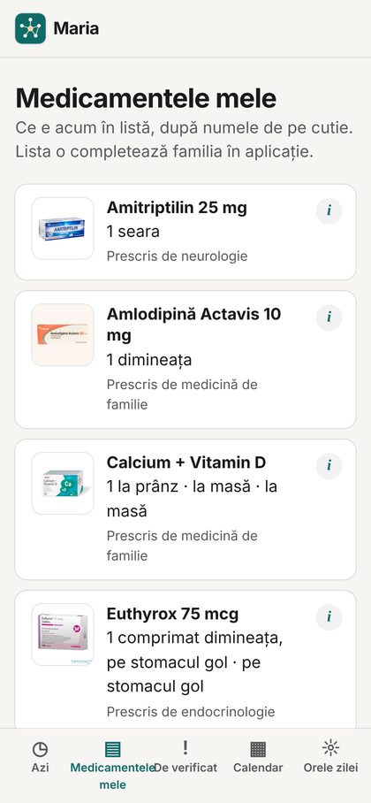 |  | 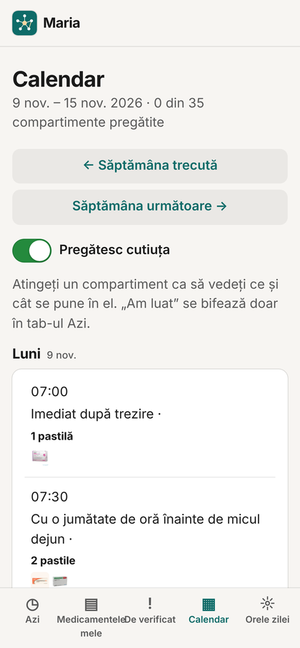 |

## Specificații tehnice

### Platforma și stack-ul

| Componentă | Tehnologie |
|---|---|
| Aplicația | iOS 18+, SwiftUI, **zero dependențe externe**: VisionKit (DataMatrix, poza cutiei), VNDocumentCamera (rețeta), Vision (OCR), Speech (ro-RO), AVSpeechSynthesizer, notificări locale, CoreImage (QR), WKWebView (graful) |
| Backend-ul | Python 3.12, FastAPI, uv; NetworkX pentru graf; rapidfuzz pentru potrivirea în nomenclator; solver propriu cu backtracking pentru program |
| Datele | SQLite: `kb.sqlite` (read-only: produse RO, substanțe, interacțiuni, reguli) și `app.sqlite` (pacienți, medicamente, doze, check-in-uri, Noutăți) |
| Web | portalul medicului și pagina familiei: Jinja + JavaScript mic, Cytoscape.js pentru graf, actualizare live prin Server-Sent Events |
| Contractele | OpenAPI + JSON Schema în [`contracts/`](contracts/), cu modelele Swift generate din ele (`make models`) |
| LLM | Gemini (tier gratuit), **doar ca rezervă** la citirea pozei și a simptomelor; rezultatul trece prin aceleași verificări |

### Arhitectura

<p align="center">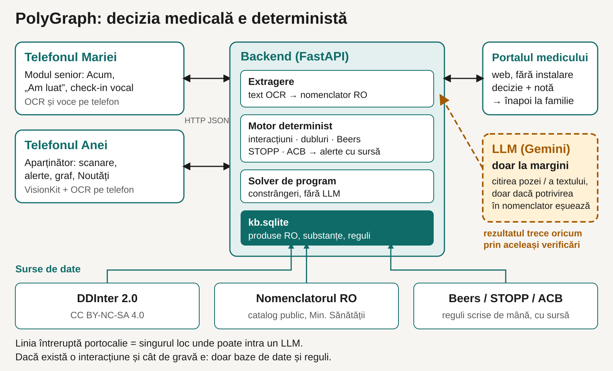</p>

Cele două telefoane (pacientul și aparținătorul) vorbesc prin JSON cu același backend. Medicul de familie folosește portalul web din browser. La hackathon, serverul e laptopul care rulează `make demo`; telefoanele îl găsesc în aceeași rețea Wi-Fi.

### Unde intră LLM-ul și unde nu

| Pas | LLM? |
|---|---|
| Poză → text | **nu**: OCR-ul Apple, pe telefon |
| Text → produs, concentrație, posologie | **nu**: potrivire în catalog + parser; Gemini doar dacă potrivirea eșuează, iar rezultatul trebuie să existe în nomenclator |
| Există interacțiune? Cât de gravă? | **nu**: DDInter 2.0 + reguli YAML verificate de echipă |
| Programul zilei | **nu**: solver determinist |
| Voce → simptome | **nu**: transcriere pe telefon + vocabular fix de ~30 de simptome, cu sinonime în română |

### Pacientul demo

Maria, 78 de ani, din Timișoara, cu 8 medicamente de la 5 medici: Sintrom, Nurofen (OTC), Simvastatin, Amlodipină, Euthyrox, Calciu + D3, Omeprazol, Amitriptilină. Pe ea, motorul găsește **27 de alerte**, printre care Sintrom + Nurofen (sângerare), simvastatină + amlodipină, AINS și amitriptilină la vârstnic și scorul ACB 3. Programul ei are **5 momente pe zi**. Rețeta ORL cu Fromilid adaugă alerta **critică** simvastatină + claritromicină. Lista exactă e în [`contracts/fixtures/expected_alerts.json`](contracts/fixtures/expected_alerts.json).

### Calitatea

| Verificare | Ce acoperă |
|---|---|
| `make check` | contractele, ruff și **475 de teste pytest** (motorul pe pacientul demo, potrivirea, solverul, API-ul, portalul, pagina familiei) |
| `make check-ios` | build-ul iOS și testele unitare Swift (GS1, momentul curent, decodarea contractelor, notificările, posologia comună cu web-ul) |
| `make demo-check` | scenariul demo cap-coadă prin API, comparat cu `expected_*.json` (~1 s) |
| `make review` | turul automat pe simulator: 20 de fluxuri în 5 variante (Light, Dark, text mare, Reduce Motion, contrast mare) și turul agresiv cu 27 de teste; rapoartele sunt în [`docs/reviews/`](docs/reviews/) |

## Sursele de date și licențele

| Sursă | Ce luăm | Licență / observații |
|---|---|---|
| **DDInter 2.0** | 160.235 de perechi de interacțiuni între 1.939 de substanțe, doar nivelul; textele explicative verificate de mână pentru substanțele folosite | **CC BY-NC-SA 4.0, doar necomercial.** Bun pentru hackathon; după hackathon, date licențiate comercial |
| **Catalogul Public național al prețurilor maximale** (Ministerul Sănătății) | 6.485 de ambalaje, cu denumire, formă, concentrație, DCI și ATC; OTC-urile și suplimentele din demo, adăugate de mână | public; dicționarul pentru potrivirea textului de pe cutii |
| **AGS Beers Criteria 2023**, **STOPP/START v3** | ~25 de reguli pentru medicamentele uzuale în România | reguli scrise de mână, cu sursa citată în fiecare regulă |
| **Scala ACB** (Regenstrief) | scorul anticolinergic pentru ~50 de substanțe | `kb/rules/acb.yaml` |
| **RCP-urile** (anm.ro) | regulile de orar și efectele adverse | curate manual pentru substanțele din demo |

Nu folosim DrugBank (licența nu permite redistribuirea) și nici API-ul de interacțiuni RxNav, oprit de NLM la 2 ianuarie 2024. Detalii în `kb/raw/*/README.md` și `kb/rules/README.md`.

## Cum se rulează

Cerințe: Mac, [uv](https://docs.astral.sh/uv/), Xcode (pentru aplicație).

```bash
make setup     # hook-urile git + mediul Python (uv)
make kb        # kb/kb.sqlite din kb/raw (fișierele de date: kb/raw/*/README.md)
make demo      # backend-ul pentru scenă pe :8000; afișează adresa și un cod QR
make check     # contracte + ruff + pytest
```

- **Portalul medicului:** `http://localhost:8000/portal`, cod de acces `medic-demo`.
- **Pagina familiei:** din aplicație, Setări → „Deschide pe web”; în modul demo, direct la `http://localhost:8000/acasa/demo`.
- **Aplicația iOS:** deschideți `app/PolyGraph.xcodeproj` în Xcode, alegeți un iPhone sau simulatorul și rulați (⌘R). În Setări → Avansat, adresa serverului e cea afișată de `make demo`. Pașii de semnare: [`app/README.md`](app/README.md).
- **Scenariul demo prin API:** `make demo-check URL=http://127.0.0.1:8000`. La final resetează pacientul demo pentru scenă.

Cum lucrăm: [`CONTRIBUTING.md`](CONTRIBUTING.md). Designul: [`docs/DESIGN.md`](docs/DESIGN.md). Planul complet: [`docs/PLAN.md`](docs/PLAN.md).

## Ce NU face

- Nu pune diagnostice, nu schimbă și nu oprește medicamente și nu recomandă doze. Spune „discutați cu medicul de familie”, iar ce e grav ajunge la familie și la medic, nu doar la pacient.
- Nu înlocuiește medicul de familie. Îi aduce informația pe care altfel n-o vede: OTC-urile și rețetele de la alți specialiști.
- Lipsa unei alerte nu înseamnă că un medicament e sigur. „Pot să iau…?” nu răspunde niciodată „da”.
- Nu e dispozitiv medical certificat. E un prototip, iar încadrarea de reglementare (MDR) rămâne de confirmat cu un specialist.
- Nu se conectează la CNAS: lista vine din ce scanează familia. Integrarea realistă e prin softul de cabinet al medicului de familie, ca pas după un pilot ([`docs/PLAN.md`](docs/PLAN.md), secțiunea 6).

## Structura repo-ului

| Folder | Ce e |
|---|---|
| `app/` | proiectul Xcode (SwiftUI), cu testele unitare și turul de review pe simulator |
| `backend/` | FastAPI: extragerea, motorul de alerte, solverul, vocea, portalul și pagina familiei, testele |
| `kb/` | ingestia datelor, regulile YAML, interacțiunile verificate de mână |
| `contracts/` | API-ul, schemele și fixture-urile demo: sursa de adevăr între aplicație și backend |
| `demo/` | pozele cutiilor, rețeta demo, transcrierile |
| `docs/` | [planul](docs/PLAN.md), [designul](docs/DESIGN.md), [review-urile](docs/reviews/), [pitch-ul](docs/pitch/), capturile |

## Echipa

Mihai-Vladimir Ghimpău și Mihnea-Florin Remețan.
